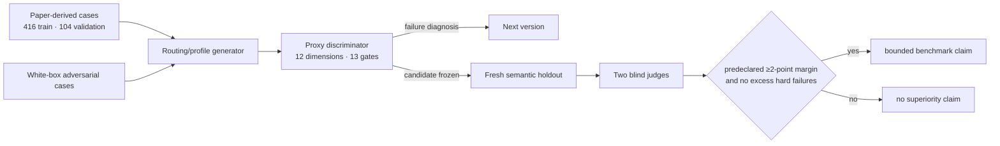
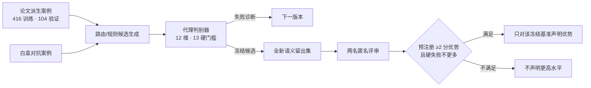
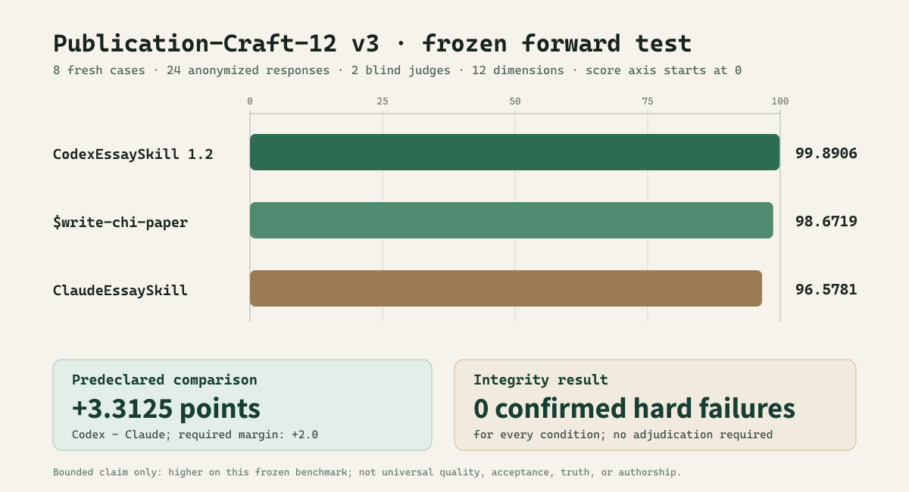

# CodexEssaySkill — evidence-constrained conference-paper writing / CodexEssaySkill——证据约束的会议论文写作 Skill

**English**

> A private Codex writing skill with a public, auditable demonstration record. It diagnoses research
> architecture before editing prose, preserves evidence and paradigm boundaries, and produces the
> requested reader-facing artifact instead of stopping at generic advice.

The executable skill is kept in the private `Shawn200212/CodexEssaySkill-core` repository. This
public repository contains the method, frozen rubric, aggregate measurements, synthetic examples,
and visualizations—never the private skill source, hidden issue manifests, raw candidate answers, or
unpublished user manuscripts.

> **Current scope.** The active Skill is now the evidence/provenance and revision-control layer,
> not an end-to-end prose writer. See [current scope](docs/current-scope.md). Historical results
> below are retained as an auditable record, not a claim about the active version's writing quality.

**中文**

> 一个采用“私有核心 + 公开演示”结构的 Codex 论文写作 Skill。它先诊断研究架构，再修改
> 文本；先守住证据、方法范式与作者立场，再追求流畅；被要求改写时，首先交付可直接放入
> 论文的文本，而不是停在通用检查表。

可执行 Skill 位于私有仓库 `Shawn200212/CodexEssaySkill-core`。本公开仓库只发布方法、冻结
量表、聚合测量、合成示例和可视化，不公开 Skill 源码、隐藏问题清单、候选原始回答、未发表
手稿或用户数据。

> **当前边界。** 活跃 Skill 已调整为证据/溯源与修订控制层，不再承担端到端论文文本撰写。
> 见[当前边界](docs/current-scope.zh-CN.md)。下方历史结果仅保留为可审计记录，不能证明当前版本的写作质量。

## Current CHI source snapshot / 当前 CHI 源码快照

**English**

The private core now also carries a current, CHI-focused chi-paper source snapshot dated
2026-08-13. Its source SHA-256 is
2F40D48F1F05D23D20B5714485595D4719EA5856913AF541D143D68418CA9063. Five tool tests passed at
synchronization; a six-case routing and safety smoke test produced its six expected outcomes.
Neither result is a generalization, manuscript-quality, or publication-outcome claim, and this
snapshot does not replace or alter the frozen CodexEssaySkill 1.2.0 benchmark. See the
[current source snapshot record](docs/current-chi-paper-snapshot.md) for boundaries and provenance.

**中文**

私有核心仓库现另行保存一个日期为 2026-08-13 的当前 CHI 定向 chi-paper 源码快照，其
SHA-256 为 2F40D48F1F05D23D20B5714485595D4719EA5856913AF541D143D68418CA9063。本次同步时，
五项工具测试均通过；一次六案例的路由与安全冒烟测试也获得六项预期结果。这些结果不是泛化、
论文质量或发表结果主张；该快照不会替代或改变已经冻结的 CodexEssaySkill 1.2.0 基准。
边界与来源见[当前源码快照记录](docs/current-chi-paper-snapshot.md)。

## Why this successor exists / 为什么要做这个后继版本

**English**

`CodexEssaySkill` began from an audit of
[`ClaudeEssaySkill`](https://github.com/Shawn200212/ClaudeEssaySkill) and its owner-authorized private
core snapshot. The predecessor's strongest idea is methodological: measure what can be measured,
keep generator and evaluator roles separate, turn discovered failures into patches, and retire every
seen challenge set from holdout status.

This successor keeps that discipline and expands the object being evaluated. A detector or fluent
paragraph cannot establish that a paper has a publication thesis, that every claim has the right unit
and denominator, or that a qualitative/design contribution retained its epistemology. The new skill
therefore optimizes a twelve-dimension publication model with thirteen disqualifying integrity gates.

**中文**

本项目首先审计了 [`ClaudeEssaySkill`](https://github.com/Shawn200212/ClaudeEssaySkill) 及其经
仓库所有者授权读取的私有核心快照。其最重要的贡献不是某个“AI 检测分数”，而是方法纪律：
能测量的才测量；生成与评估分离；失败必须变成可回归的修订；一旦某组挑战参与了修订，它就
不再是假装未知的最终测试集。

`CodexEssaySkill` 将评估对象从“像不像正常论文文本”扩展到“是否构成可发表的研究论证”。
一段流畅文字不能证明论文有真正的发布主张，也不能证明因变量、分析单位、分母和推断强度
一致，更不能证明质性或设计研究没有被强行改写成实验论文。因此，新 Skill 使用 12 个发布级
维度与 13 个完整性硬门槛。

## What the skill does differently / 核心能力

**English**

| Layer | Required artifact |
|---|---|
| Research architecture | publication thesis, contribution ledger, proof-obligation map, section warrant chain |
| Evidence discipline | claim–evidence–scope matrix, exact pointers, units, denominators, alternatives, maximum claim force |
| Paradigm fit | experimental, qualitative, interpretive, RtD/arts, systems, review, replication, dataset, theoretical, or mixed-method warrants |
| Publication craft | intellectual pressure, paragraph-level reasoning, contribution-shaped interpretation, concrete follow-through |
| Humanistic revision | visible human/material/institutional/model agency; precise constructs; author stance; no ceremonial jargon |
| Integrity | preservation of consequential nulls, harms, resistance, quotations, citations, provenance, and revision meaning |
| Venue care | current official rules re-verified for every named venue and year; CHI/HCI and games/XR/AI-game specialization |

See the [architecture](docs/architecture.md) and the complete public
[Publication-Craft-12 rubric](data/rubric.json).

**中文**

| 层级 | 必须形成的对象 |
|---|---|
| 研究架构 | 发布主张、贡献账本、证明义务图、章节论证链 |
| 证据纪律 | 主张—证据—范围矩阵、精确证据指针、单位、分母、替代解释、最大可辩护语气 |
| 范式适配 | 实验、质性、解释性、RtD/艺术、系统、综述、复现、数据集、理论及混合方法各自的证明规则 |
| 发布文本 | 明确的智识压力、段落推理、由贡献组织的解释、可执行的后续研究动作 |
| 人文表达 | 让人、材料、制度与模型的能动性和劳动可见；保留作者立场；去除仪式化黑话 |
| 修订完整性 | 保留关键零结果、伤害、抵抗、引文、引用、来源和原意，检测数字与主张强度漂移 |
| 会务适配 | 对每个明确会议与年份重新核验官方规则；专门支持 CHI/HCI、游戏、XR 与 AI 游戏研究 |

完整结构见[架构说明](docs/architecture.md)，公开量表见
[Publication-Craft-12](data/rubric.json)。

## The training is GAN-shaped, not neural fine-tuning / “GaNS 训练”到底是什么

**English**

No model weights were trained. The private core evolves instruction modules, routing weights,
capability floors, and hard-gate contracts. A white-box adversary creates failure-seeking tasks; an
isolated generator uses one frozen skill; blind judges score shuffled responses; a challenge becomes
calibration as soon as its diagnosis informs a patch.

Round 2 is deliberately published as a rejected run: its average proxy improved while the weakest
task family regressed. The first semantic comparison is also retained as calibration because all
three candidates clustered near the ceiling; `CodexEssaySkill 1.0.0` led `ClaudeEssaySkill` by only
0.0782 points, below the predeclared 2-point practical margin. Those failures produced v1.1's
artifact-first and publication-craft changes, followed by a new post-freeze holdout.

**中文**

这里没有训练模型权重，也没有神经网络 GAN。私有核心迭代的是指令模块、任务路由、能力下限
和安全门槛：白盒对抗者负责寻找失败，隔离生成器只使用一个冻结 Skill，匿名回答按固定种子
洗牌，两名盲评者依据同一量表评分。任何已经影响修订的题集自动降级为校准集。

第二轮即使平均代理分上升，也因最弱任务族退化而被保留为拒绝样本。第一次语义比较同样没有
被包装成胜利：三个候选都接近满分，`CodexEssaySkill 1.0.0` 仅领先
`ClaudeEssaySkill` 0.0782 分，未达到事先规定的 2 分实际差异。该组题随后成为校准集，推动
v1.1 加入“先交付论文文本”、证据骨架完整覆盖和 publication-craft 规则，再用全新题集做
冻结后验证。

## Final frozen comparison / 最终冻结比较

**English**

Publication-Craft-12 v3 was authored after `CodexEssaySkill 1.2.0` was frozen. Eight new cases
produced 24 responses, shuffled independently by case and scored by two context-isolated judges on
the same twelve dimensions.

| Frozen condition | Score (0–100) | Confirmed hard-failure cases |
|---|---:|---:|
| **CodexEssaySkill 1.2.0** | **99.8906** | 0 |
| predecessor `$write-chi-paper` | 98.6719 | 0 |
| ClaudeEssaySkill snapshot | 96.5781 | 0 |

CodexEssaySkill led ClaudeEssaySkill by **3.3125 points**, exceeding the predeclared 2.0-point
practical margin with no additional hard failures. The valid statement is deliberately narrow:
**CodexEssaySkill 1.2.0 scored higher on the frozen Publication-Craft-12 v3 benchmark.** It is not a
claim about all papers, all models, scientific truth, or acceptance. Full aggregate results are in
the [benchmark report](reports/benchmark.md) and [visual gallery](gallery/benchmark.html).

**中文**

Publication-Craft-12 v3 在 `CodexEssaySkill 1.2.0` 冻结后独立编写。8 个新案例产生 24 个回答，
逐题随机换标，再由两名无历史上下文的评审按同一套 12 维量表评分。

| 冻结条件 | 得分（0–100） | 确认硬失败案例 |
|---|---:|---:|
| **CodexEssaySkill 1.2.0** | **99.8906** | 0 |
| 前身 `$write-chi-paper` | 98.6719 | 0 |
| ClaudeEssaySkill 快照 | 96.5781 | 0 |

CodexEssaySkill 领先 ClaudeEssaySkill **3.3125 分**，超过预先规定的 2.0 分实际差异，且没有
增加硬失败。能够成立的表述被严格限定为：**CodexEssaySkill 1.2.0 在冻结的
Publication-Craft-12 v3 基准上得分更高。** 这不是对所有论文、所有模型、科学真值或录用率的
普遍声明。聚合结果见[基准报告](reports/benchmark.md)和[可视化页面](gallery/benchmark.html)。

## What is published here / 公开内容

**English**

| Path | Contents |
|---|---|
| [`data/rubric.json`](data/rubric.json) | frozen twelve-dimension scoring model and hard gates |
| [`data/protocol.json`](data/protocol.json) | frozen comparison rule, candidate hash, counts, and integrity hashes |
| [`data/training_summary.json`](data/training_summary.json) | aggregate deterministic-round and semantic-test results |
| [`data/source_snapshot.json`](data/source_snapshot.json) | exact predecessor commits used for method comparison |
| [`docs/adversarial-protocol.md`](docs/adversarial-protocol.md) | role firewall, retirement rule, anti-degeneracy rules, limits |
| [`docs/evaluation-boundaries.md`](docs/evaluation-boundaries.md) | what the benchmark can and cannot support |
| [`reports/`](reports/) | aggregate report and synthetic before/after demonstration |
| [`gallery/`](gallery/) | self-contained visual result page |

**中文**

| 路径 | 内容 |
|---|---|
| [`data/rubric.json`](data/rubric.json) | 冻结的 12 维评分模型与硬失败项 |
| [`data/protocol.json`](data/protocol.json) | 冻结比较规则、候选哈希、计数和完整性哈希 |
| [`data/training_summary.json`](data/training_summary.json) | 多轮确定性迭代及语义测试的聚合结果 |
| [`data/source_snapshot.json`](data/source_snapshot.json) | 用于方法对照的前身仓库精确提交号 |
| [`docs/adversarial-protocol.md`](docs/adversarial-protocol.md) | 角色隔离、题集退役、反退化规则和限制 |
| [`docs/evaluation-boundaries.md`](docs/evaluation-boundaries.md) | 基准可以与不可以支持的结论 |
| [`reports/`](reports/) | 聚合报告与独立合成的前后对照示例 |
| [`gallery/`](gallery/) | 自包含可视化页面 |

## Access / 获取私有核心

**English**

The installable skill, reference files, scripts, private paper-derived cases, hidden manifests, raw
candidate answers, judges, and candidate mapping live in the private core. Open an issue here with
your intended research-writing use to request access. Public GitHub content cannot be technically
viewable while clone-restricted, so the demonstration/core split is intentional.

**中文**

安装用 Skill、参考文件、脚本、论文派生案例、隐藏清单、原始回答、评审记录和候选映射均在
私有 core 仓库。可在本仓库提交 issue，说明研究写作用途后申请访问。“公开可阅读但禁止
克隆”并不是 GitHub 支持的仓库模式，因此这里采用公开演示与私有核心分离。

## Honest limits / 诚实边界

**English**

- A synthetic benchmark does not predict conference acceptance or establish scientific truth.
- One generator run and two model-assisted judges do not replace human peer review or multi-model
  replication.
- The benchmark measures skill-conditioned outputs on named frozen cases, not universal superiority.
- The prose audit does **not** detect authorship or report an “AI-written percentage.” Observable
  style indicators can locate passages for review, but cannot identify who wrote them.
- The skill cannot repair missing evidence. It returns bounded prose, explicit placeholders, or
  `EVIDENCE BLOCKED` instead of inventing support.

**中文**

- 合成基准不能预测会议录用，也不能证明研究结论为真。
- 单次生成与两名模型辅助评审不能替代人工同行评议或多模型复现。
- 结果只适用于明确写出的冻结候选、题集、生成与评审协议，不代表普遍优越性。
- 文本审计不检测作者身份，也不输出“AI 写作占比”。可观察的风格指标只能定位待复核段落。
- 缺失证据不会被文风修复；Skill 会返回收窄后的文本、可见占位符或 `EVIDENCE BLOCKED`。

## License / 许可

**English**

Private source and skill content: all rights reserved, access by invitation. Aggregate measurements
and the public rubric in `data/`: [CC BY 4.0](LICENSE-DATA).

**中文**

私有源码与 Skill 内容保留全部权利，仅限获邀访问。`data/` 中的聚合测量和公开量表采用
[CC BY 4.0](LICENSE-DATA)。
