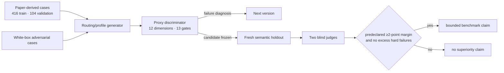

# CodexEssaySkill — evidence-constrained conference-paper writing

**English** | [中文](README.zh-CN.md)

> A private Codex writing skill with a public, auditable demonstration record. It diagnoses research
> architecture before editing prose, preserves evidence and paradigm boundaries, and produces the
> requested reader-facing artifact instead of stopping at generic advice.

The executable skill is kept in the private `Shawn200212/CodexEssaySkill-core` repository. This
public repository contains the method, frozen rubric, aggregate measurements, synthetic examples,
and visualizations—never the private skill source, hidden issue manifests, raw candidate answers, or
unpublished user manuscripts.

> **Current scope.** The active Skill is now the evidence/provenance and revision-control layer,
> not an end-to-end prose writer. See [current scope](docs/current-scope.md). Historical results
> below are retained as an auditable record, not a claim about the active version's writing quality.

## Current CHI source snapshot

The private core now also carries a current, CHI-focused chi-paper source snapshot dated
2026-08-13. Its source SHA-256 is
2F40D48F1F05D23D20B5714485595D4719EA5856913AF541D143D68418CA9063. Five tool tests passed at
synchronization; a six-case routing and safety smoke test produced its six expected outcomes.
Neither result is a generalization, manuscript-quality, or publication-outcome claim, and this
snapshot does not replace or alter the frozen CodexEssaySkill 1.2.0 benchmark. See the
[current source snapshot record](docs/current-chi-paper-snapshot.md) for boundaries and provenance.

## Why this successor exists

`CodexEssaySkill` began from an audit of
[`ClaudeEssaySkill`](https://github.com/Shawn200212/ClaudeEssaySkill) and its owner-authorized private
core snapshot. The predecessor's strongest idea is methodological: measure what can be measured,
keep generator and evaluator roles separate, turn discovered failures into patches, and retire every
seen challenge set from holdout status.

This successor keeps that discipline and expands the object being evaluated. A detector or fluent
paragraph cannot establish that a paper has a publication thesis, that every claim has the right unit
and denominator, or that a qualitative/design contribution retained its epistemology. The new skill
therefore optimizes a twelve-dimension publication model with thirteen disqualifying integrity gates.

## What the skill does differently

| Layer | Required artifact |
|---|---|
| Research architecture | publication thesis, contribution ledger, proof-obligation map, section warrant chain |
| Evidence discipline | claim–evidence–scope matrix, exact pointers, units, denominators, alternatives, maximum claim force |
| Paradigm fit | experimental, qualitative, interpretive, RtD/arts, systems, review, replication, dataset, theoretical, or mixed-method warrants |
| Publication craft | intellectual pressure, paragraph-level reasoning, contribution-shaped interpretation, concrete follow-through |
| Humanistic revision | visible human/material/institutional/model agency; precise constructs; author stance; no ceremonial jargon |
| Integrity | preservation of consequential nulls, harms, resistance, quotations, citations, provenance, and revision meaning |
| Venue care | current official rules re-verified for every named venue and year; CHI/HCI and games/XR/AI-game specialization |

See the [architecture](docs/architecture.md) and the complete public
[Publication-Craft-12 rubric](data/rubric.json).

## The training is GAN-shaped, not neural fine-tuning

No model weights were trained. The private core evolves instruction modules, routing weights,
capability floors, and hard-gate contracts. A white-box adversary creates failure-seeking tasks; an
isolated generator uses one frozen skill; blind judges score shuffled responses; a challenge becomes
calibration as soon as its diagnosis informs a patch.

Round 2 is deliberately published as a rejected run: its average proxy improved while the weakest
task family regressed. The first semantic comparison is also retained as calibration because all
three candidates clustered near the ceiling; `CodexEssaySkill 1.0.0` led `ClaudeEssaySkill` by only
0.0782 points, below the predeclared 2-point practical margin. Those failures produced v1.1's
artifact-first and publication-craft changes, followed by a new post-freeze holdout.

## Final frozen comparison

Publication-Craft-12 v3 was authored after `CodexEssaySkill 1.2.0` was frozen. Eight new cases
produced 24 responses, shuffled independently by case and scored by two context-isolated judges on
the same twelve dimensions.

| Frozen condition | Score (0–100) | Confirmed hard-failure cases |
|---|---:|---:|
| **CodexEssaySkill 1.2.0** | **99.8906** | 0 |
| predecessor `$write-chi-paper` | 98.6719 | 0 |
| ClaudeEssaySkill snapshot | 96.5781 | 0 |

CodexEssaySkill led ClaudeEssaySkill by **3.3125 points**, exceeding the predeclared 2.0-point
practical margin with no additional hard failures. The valid statement is deliberately narrow:
**CodexEssaySkill 1.2.0 scored higher on the frozen Publication-Craft-12 v3 benchmark.** It is not a
claim about all papers, all models, scientific truth, or acceptance. Full aggregate results are in
the [benchmark report](reports/benchmark.md) and [visual gallery](gallery/benchmark.html).

## What is published here

| Path | Contents |
|---|---|
| [`data/rubric.json`](data/rubric.json) | frozen twelve-dimension scoring model and hard gates |
| [`data/protocol.json`](data/protocol.json) | frozen comparison rule, candidate hash, counts, and integrity hashes |
| [`data/training_summary.json`](data/training_summary.json) | aggregate deterministic-round and semantic-test results |
| [`data/source_snapshot.json`](data/source_snapshot.json) | exact predecessor commits used for method comparison |
| [`docs/adversarial-protocol.md`](docs/adversarial-protocol.md) | role firewall, retirement rule, anti-degeneracy rules, limits |
| [`docs/evaluation-boundaries.md`](docs/evaluation-boundaries.md) | what the benchmark can and cannot support |
| [`reports/`](reports/) | aggregate report and synthetic before/after demonstration |
| [`gallery/`](gallery/) | self-contained visual result page |

## Access

The installable skill, reference files, scripts, private paper-derived cases, hidden manifests, raw
candidate answers, judges, and candidate mapping live in the private core. Open an issue here with
your intended research-writing use to request access. Public GitHub content cannot be technically
viewable while clone-restricted, so the demonstration/core split is intentional.

## Honest limits

- A synthetic benchmark does not predict conference acceptance or establish scientific truth.
- One generator run and two model-assisted judges do not replace human peer review or multi-model
  replication.
- The benchmark measures skill-conditioned outputs on named frozen cases, not universal superiority.
- The prose audit does **not** detect authorship or report an “AI-written percentage.” Observable
  style indicators can locate passages for review, but cannot identify who wrote them.
- The skill cannot repair missing evidence. It returns bounded prose, explicit placeholders, or
  `EVIDENCE BLOCKED` instead of inventing support.

## License

Private source and skill content: all rights reserved, access by invitation. Aggregate measurements
and the public rubric in `data/`: [CC BY 4.0](LICENSE-DATA).
