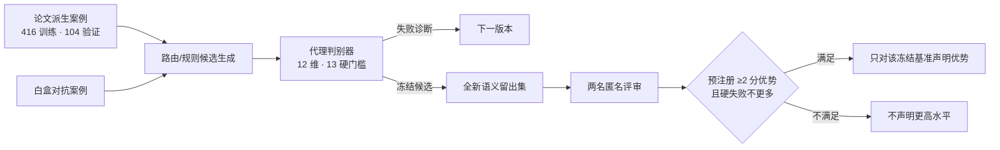
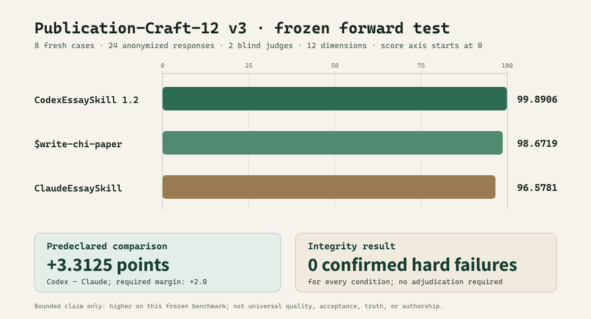

# CodexEssaySkill——证据约束的会议论文写作 Skill

[English](README.md) | **中文**

> 一个采用“私有核心 + 公开演示”结构的 Codex 论文写作 Skill。它先诊断研究架构，再修改
> 文本；先守住证据、方法范式与作者立场，再追求流畅；被要求改写时，首先交付可直接放入
> 论文的文本，而不是停在通用检查表。

可执行 Skill 位于私有仓库 `Shawn200212/CodexEssaySkill-core`。本公开仓库只发布方法、冻结
量表、聚合测量、合成示例和可视化，不公开 Skill 源码、隐藏问题清单、候选原始回答、未发表
手稿或用户数据。

## 为什么要做这个后继版本

本项目首先审计了 [`ClaudeEssaySkill`](https://github.com/Shawn200212/ClaudeEssaySkill) 及其经
仓库所有者授权读取的私有核心快照。其最重要的贡献不是某个“AI 检测分数”，而是方法纪律：
能测量的才测量；生成与评估分离；失败必须变成可回归的修订；一旦某组挑战参与了修订，它就
不再是假装未知的最终测试集。

`CodexEssaySkill` 将评估对象从“像不像正常论文文本”扩展到“是否构成可发表的研究论证”。
一段流畅文字不能证明论文有真正的发布主张，也不能证明因变量、分析单位、分母和推断强度
一致，更不能证明质性或设计研究没有被强行改写成实验论文。因此，新 Skill 使用 12 个发布级
维度与 13 个完整性硬门槛。

## 核心能力

| 层级 | 必须形成的对象 |
|---|---|
| 研究架构 | 发布主张、贡献账本、证明义务图、章节论证链 |
| 证据纪律 | 主张—证据—范围矩阵、精确证据指针、单位、分母、替代解释、最大可辩护语气 |
| 范式适配 | 实验、质性、解释性、RtD/艺术、系统、综述、复现、数据集、理论及混合方法各自的证明规则 |
| 发布文本 | 明确的智识压力、段落推理、由贡献组织的解释、可执行的后续研究动作 |
| 人文表达 | 让人、材料、制度与模型的能动性和劳动可见；保留作者立场；去除仪式化黑话 |
| 修订完整性 | 保留关键零结果、伤害、抵抗、引文、引用、来源和原意，检测数字与主张强度漂移 |
| 会务适配 | 对每个明确会议与年份重新核验官方规则；专门支持 CHI/HCI、游戏、XR 与 AI 游戏研究 |

完整结构见[架构说明](docs/architecture.md)，公开量表见
[Publication-Craft-12](data/rubric.json)。

## “GaNS 训练”到底是什么

这里没有训练模型权重，也没有神经网络 GAN。私有核心迭代的是指令模块、任务路由、能力下限
和安全门槛：白盒对抗者负责寻找失败，隔离生成器只使用一个冻结 Skill，匿名回答按固定种子
洗牌，两名盲评者依据同一量表评分。任何已经影响修订的题集自动降级为校准集。

第二轮即使平均代理分上升，也因最弱任务族退化而被保留为拒绝样本。第一次语义比较同样没有
被包装成胜利：三个候选都接近满分，`CodexEssaySkill 1.0.0` 仅领先
`ClaudeEssaySkill` 0.0782 分，未达到事先规定的 2 分实际差异。该组题随后成为校准集，推动
v1.1 加入“先交付论文文本”、证据骨架完整覆盖和 publication-craft 规则，再用全新题集做
冻结后验证。

## 最终冻结比较

Publication-Craft-12 v3 在 `CodexEssaySkill 1.2.0` 冻结后独立编写。8 个新案例产生 24 个回答，
逐题随机换标，再由两名无历史上下文的评审按同一套 12 维量表评分。

| 冻结条件 | 得分（0–100） | 确认硬失败案例 |
|---|---:|---:|
| **CodexEssaySkill 1.2.0** | **99.8906** | 0 |
| 前身 `$write-chi-paper` | 98.6719 | 0 |
| ClaudeEssaySkill 快照 | 96.5781 | 0 |

CodexEssaySkill 领先 ClaudeEssaySkill **3.3125 分**，超过预先规定的 2.0 分实际差异，且没有
增加硬失败。能够成立的表述被严格限定为：**CodexEssaySkill 1.2.0 在冻结的
Publication-Craft-12 v3 基准上得分更高。** 这不是对所有论文、所有模型、科学真值或录用率的
普遍声明。聚合结果见[基准报告](reports/benchmark.md)和[可视化页面](gallery/benchmark.html)。

## 公开内容

| 路径 | 内容 |
|---|---|
| [`data/rubric.json`](data/rubric.json) | 冻结的 12 维评分模型与硬失败项 |
| [`data/protocol.json`](data/protocol.json) | 冻结比较规则、候选哈希、计数和完整性哈希 |
| [`data/training_summary.json`](data/training_summary.json) | 多轮确定性迭代及语义测试的聚合结果 |
| [`data/source_snapshot.json`](data/source_snapshot.json) | 用于方法对照的前身仓库精确提交号 |
| [`docs/adversarial-protocol.md`](docs/adversarial-protocol.md) | 角色隔离、题集退役、反退化规则和限制 |
| [`docs/evaluation-boundaries.md`](docs/evaluation-boundaries.md) | 基准可以与不可以支持的结论 |
| [`reports/`](reports/) | 聚合报告与独立合成的前后对照示例 |
| [`gallery/`](gallery/) | 自包含可视化页面 |

## 获取私有核心

安装用 Skill、参考文件、脚本、论文派生案例、隐藏清单、原始回答、评审记录和候选映射均在
私有 core 仓库。可在本仓库提交 issue，说明研究写作用途后申请访问。“公开可阅读但禁止
克隆”并不是 GitHub 支持的仓库模式，因此这里采用公开演示与私有核心分离。

## 诚实边界

- 合成基准不能预测会议录用，也不能证明研究结论为真。
- 单次生成与两名模型辅助评审不能替代人工同行评议或多模型复现。
- 结果只适用于明确写出的冻结候选、题集、生成与评审协议，不代表普遍优越性。
- 文本审计不检测作者身份，也不输出“AI 写作占比”。可观察的风格指标只能定位待复核段落。
- 缺失证据不会被文风修复；Skill 会返回收窄后的文本、可见占位符或 `EVIDENCE BLOCKED`。

## 许可

私有源码与 Skill 内容保留全部权利，仅限获邀访问。`data/` 中的聚合测量和公开量表采用
[CC BY 4.0](LICENSE-DATA)。

## 当前 CHI 源码快照

私有核心仓库现另行保存一个日期为 2026-08-13 的当前 CHI 定向 chi-paper 源码快照，其
SHA-256 为 2F40D48F1F05D23D20B5714485595D4719EA5856913AF541D143D68418CA9063。本次同步时，
五项工具测试均通过；一次六案例的路由与安全冒烟测试也获得六项预期结果。这些结果不是泛化、
论文质量或发表结果主张；该快照不会替代或改变已经冻结的 CodexEssaySkill 1.2.0 基准。
边界与来源见[当前源码快照记录](docs/current-chi-paper-snapshot.md)。
