# CodexEssaySkill architecture

CodexEssaySkill is one evidence-constrained writing skill with conditional routes, not a stack of
independent prose filters. It diagnoses the paper before polishing it and keeps semantic preservation
as a release gate.

```mermaid
flowchart LR
    M["Manuscript or research packet"] --> B["Evidence boundary"]
    B --> T["Publication thesis"]
    T --> C["Contribution ledger"]
    C --> E["Claim-evidence-scope matrix"]
    E --> P["Proof obligations and section warrants"]
    P --> R{"Task route"}
    R -->|"CHI / HCI / games / XR / AI games"| H["Domain and venue route"]
    R -->|"Experimental / qualitative / design / systems / review"| G["Paradigm route"]
    H --> D["Reader-facing artifact"]
    G --> D
    D --> I["Integrity and preservation audit"]
    I -->|"Complete"| O["Artifact + change ledger + residual risks"]
    I -->|"Evidence blocked"| X["Bounded prose + exact missing evidence"]
```

## The publication model

The core skill treats each paper as four linked objects:

1. a publication thesis that states the unresolved pressure, intellectual move, decisive evidence,
   beneficiary, and boundary;
2. a contribution ledger that separates novelty from project activity;
3. a claim-evidence-scope matrix that fixes constructs, units, pointers, alternatives, and maximum
   claim force;
4. a proof-obligation map that gives every study, comparison, deployment, or analysis one job.

This architecture supports CHI-specific work without forcing every manuscript into CHI's empirical
paper conventions. Qualitative, interpretive, research-through-design, arts, systems, theoretical,
review, replication, and mixed-method work retain their own warrants.

## The integrity model

Thirteen hard gates prohibit invented evidence, silent claim strengthening, paradigm conversion,
unit substitution, erasure of consequential nulls or harms, quotation drift, hidden human-AI labor,
authorship-percentage claims, acceptance predictions, provenance violations, incomplete checks
reported as passes, and failure to deliver the requested artifact.

The bundled text audit therefore reports observable prose tendencies only. It can locate defensive,
vague, abstract, repetitive, or templated passages; it cannot identify an author or calculate an
"AI-written percentage."
